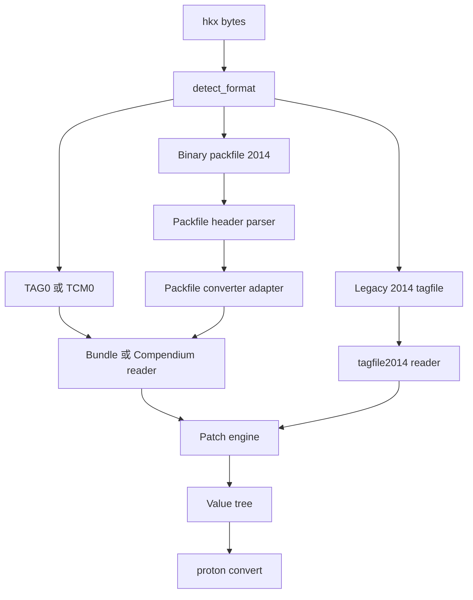

## User Requirements

用户要求在已有项目进度基础上制定“下一步”计划，且明确本次只规划、不执行修改。经澄清，下一步方向为 hkx packfile 和版本补丁补全，范围覆盖该方向内 README 列出的全部余项，不扩展到 CharacterControl 或 Ragdoll 剩余项。

## Product Overview

为现有 hkx 加载链路补齐两类能力：一是让 2014 binary packfile 输入进入可诊断、可验证的容器处理路径；二是把版本补丁从结构型扩展到函数型和 type-change 型。完成后，开发者加载旧格式或旧版本资产时，可获得明确的分流、转换、补丁应用与错误语义，而不是只识别文件头或静默缺少能力。

## Core Features

- Packfile 入口：识别并解析 2014 binary packfile 头部，校验 magic、user tag 和 file version；提供外部转换边界，把 packfile 转为现有 tagfile 读取路径可消费的数据；无转换器时返回明确错误。
- 函数型补丁：支持数据对象级和字段级补丁函数，按确定顺序作用于加载后的通用对象树，并记录调用统计，便于测试与诊断。
- Type-change 补丁：支持成员类型变更描述及转换函数，覆盖旧类型、新类型、类型名和元组信息，保证旧字段值按已注册规则转换。
- 版本链处理：按类型名和版本形成补丁链，支持连续升级、循环检测、冲突检测和确定性遍历。
- 统一加载入口：根据输入格式分流到 TAG0、compendium、legacy tagfile、packfile 适配路径，并在加载后应用补丁。
- 验证与文档：新增合成二进制测试、确定性测试、门面导出检查和 README 状态更新；明确不宣称真实 Havok 资产或缺失 DLL 的逐位兼容。

## Tech Stack Selection

- 沿用现有 Rust workspace、edition 2024、零外部依赖策略。
- 序列化能力继续集中在 `base-serialize`，保持该层不反向依赖 `phys-*`。
- 复用现有 `hff`、`tagfile`、`tagfile2014`、`compendium`、`type_meta`、`object`、`version` 模块和 generic `Value` 树。
- 门面 `proton::serialize` 已通过 `pub use base_serialize as serialize` 暴露新增公共 API，无需新增门面子模块。

## Implementation Approach

总体策略是先考证原版语义，再实现两个相对独立的补齐层：packfile 容器适配层和增强补丁引擎，最后用统一加载入口串起来。这样既覆盖所选方向的全部余项，又不改动物理仿真热路径。

关键决策如下：

1. **Packfile 采用“头部解析 + 外部转换适配”而非伪造 DLL 解析器**  
原版 `hkCompatFormats.h/.cpp` 明确通过外部 `hkCompatFormats.dll` 创建 binary packfile reader；`hkSerializeDetail.cpp` 只注册探测器和空的 create 函数。源码分发内没有该 DLL 实现，因此不能宣称内置真实 packfile 转换完成。方案新增 packfile 头部结构、版本校验、可注入转换器和明确错误；转换器把源字节转为现有 `TAG0` 或 legacy tagfile 字节后，复用已完成的 reader。收益是边界诚实、可测试、可扩展；限制是默认没有 DLL 时仍不能转换真实旧 packfile。

2. **补丁引擎在现有 `PatchInfo` 和 `PatchComponent` 上扩展**  
现有结构型补丁已能 rename、remove、add、default-set。新增函数型和 type-change 组件，避免另起一套并行补丁系统。函数以具名函数指针注册，保持确定性、可比较性和低开销；捕获状态通过显式字段表达，禁止闭包捕获环境。

3. **补丁应用改为版本链驱动**  
当前 `PatchSet::apply` 只按原始类型名和版本匹配一次。新增按 `(类型名, 版本)` 构建有序索引后循环匹配补丁目标版本，支持 v1 到 v2 再到 v3 的链式升级；设置最大迭代次数防止循环，检测同版本冲突并给出错误。索引使用有序容器，遍历顺序不依赖运行环境。

4. **错误语义显式化**  
新增统一错误类型覆盖 packfile 头部非法、版本不支持、转换器缺失、转换输出非法、补丁函数失败、type-change 失败和补丁冲突。保留 `Bundle::load` 和 `Bundle::load_with_compendia` 的既有行为，新统一入口才启用 packfile 和补丁流程。

5. **性能与确定性**  
hkx 加载属于离线路径，复杂度为补丁数加记录和字段规模。补丁索引构建为 O(P)，每条记录按版本链升级，通常为 O(R × C)。统一入口只做一次格式探测和一次转换器调用，不引入重复解析。补丁和转换函数禁止访问时钟、随机源、环境状态和网络。

## Implementation Notes

- 先由 [subagent:code-explorer] 以 very thorough 深度确认 SDK 语义，尤其是 `hkCompatFormats` 导出边界、`PATCH_DATAOBJECT_FUNCTION`、`PATCH_VAR_FUNCTION`、`PATCH_TYPE_CHANGED`、`PATCH_VAR_TYPE_CHANGED` 的调用时机和依赖约束。
- 不改变 `detect_format` 现有返回值和 magic 常量，避免影响已有 sniffing 测试。
- 不在 `base-serialize` 引入 `phys-*` 依赖；type-change 仅操作 generic `Value`，下游 `proton::convert` 不感知补丁过程。
- 修改补丁 API 时同步更新所有已知调用点，避免静默失败；新 API 返回可诊断错误，测试中覆盖失败路径。
- 所有新增测试继续使用手写合成二进制，不引入真实资产或外部 DLL；文档中明确“不支持真实 packfile 转换”的边界仍存在，除非调用方提供合法转换器。
- README 第 805 行仍称 Ragdoll 扩展余项未提交，而实际最新提交为 `4914e50`；本次文档更新需一并修正该过时状态。

## Architecture Design



组件关系：

- `loader.rs` 负责统一入口和格式分流，不承载具体解析逻辑。
- `packfile.rs` 只负责 2014 binary packfile 头部、版本和转换适配；转换成功后回到现有 reader。
- `version.rs` 负责补丁模型、索引、版本链和函数/type-change 应用。
- `object.rs`、`compendium.rs`、`tagfile2014.rs` 保持现有职责，仅被统一入口复用。
- `proton` 继续只做别名重导出，新增 API 通过 `proton::serialize::*` 可见。

## Directory Structure

```text
havok/
├── crates/base-serialize/src/
│   ├── packfile.rs
│   │   # [NEW] 2014 binary packfile 头部解析、版本校验、PackfileHeader、
│   │   # PackfileError 和 PackfileConverter 适配 trait。转换输出交给现有
│   │   # tagfile reader，不实现缺失的 DLL 内部逻辑。
│   ├── loader.rs
│   │   # [NEW] 统一 hkx 加载入口。根据 SerializeFormat 分流到 Bundle、
│   │   # Compendium、tagfile2014 或 packfile 转换路径，并在加载后应用补丁。
│   ├── version.rs
│   │   # [MODIFY] 扩展 PatchComponent、PatchInfo 和 PatchReport；新增函数型
│   │   # 补丁、type-change 补丁、PatchError、有序补丁索引、版本链应用、
│   │   # 冲突和循环检测。保留现有结构型补丁语义。
│   ├── lib.rs
│   │   # [MODIFY] 声明 packfile 与 loader 模块，导出新增公共类型和函数，
│   │   # 更新模块表和 Not ported 文档，明确 packfile 转换边界。
│   ├── object.rs
│   │   # [MODIFY 可选] 仅在统一加载需要暴露小范围辅助 API 时调整；
│   │   # 默认保持 Bundle::load 与 load_with_compendia 不变。
│   ├── compendium.rs
│   │   # [NO CHANGE] 复用现有 TCM0 合订本加载与签名校验。
│   ├── tagfile2014.rs
│   │   # [NO CHANGE] 复用 2014 legacy binary tagfile 解析。
│   └── type_meta.rs
│       # [NO CHANGE] 复用 TypeMeta 和版本信息，不新增反向依赖。
├── tests/
│   ├── hkx_packfile_and_function_patches.rs
│   │   # [NEW] packfile 头部、转换器注入、失败路径、函数型补丁、
│   │   # type-change、版本链和确定性集成测试。
│   ├── hkx_version_patching.rs
│   │   # [MODIFY] 适配补丁 API 变更，补充函数型和 type-change 场景，
│   │   # 保留原有结构型补丁断言。
│   ├── hkx_object_loading.rs
│   │   # [MODIFY 可选] 如统一入口替换测试中的显式加载流程，则补充 smoke test。
│   └── hkx_scene_loading.rs
│       # [MODIFY 可选] 如新增统一入口端到端场景，则追加跨加载逐位一致断言。
├── README.md
│   # [MODIFY] 新增已完成子集说明；更新第 4 节交付表、第 8 节当前状态、
│   # 剩余事项列表、仓库现状和第 9 节文档索引；修正过时提交状态说明。
└── docs/
    # [NO CHANGE] phase9-test-matrix 不涉及本次验收范围。
```

## Validation Plan

- 单元测试：packfile 头部全字段、非法 magic、短输入、不支持版本、转换器缺失、转换输出非法；补丁索引、版本链、循环检测、冲突检测、函数补丁调用次数、type-change 值转换。
- 集成测试：合成 packfile 经转换器进入现有 reader；函数型补丁修改记录和字段；type-change 将旧值按注册函数转换；连续版本补丁结果与一次性期望一致；相同输入两次加载产生相同字段顺序和值。
- 回归测试：`tests/hkx_scene_loading.rs` 的 hkx 到 world 端到端场景继续通过，保留跨加载逐位一致断言。
- 全量命令：
- `cargo fmt --all -- --check`
- `cargo clippy --workspace --all-targets -- -D warnings`
- `cargo test --workspace`
- `cargo build --workspace --release`
- `$env:RUSTDOCFLAGS='-D warnings'; cargo doc --workspace --no-deps`

## SubAgent

- **code-explorer**
- Purpose: 以 very thorough 深度考证原版 SDK 中 binary packfile 的外部转换边界、函数型补丁和 type-change 补丁的精确语义，并定位 Rust 侧所有需修改文件、调用点和测试点。
- Expected outcome: 输出逐文件现状结论、SDK 对应行为摘录、不可移植项清单、补丁应用顺序和冲突处理建议，供实现阶段直接落地。